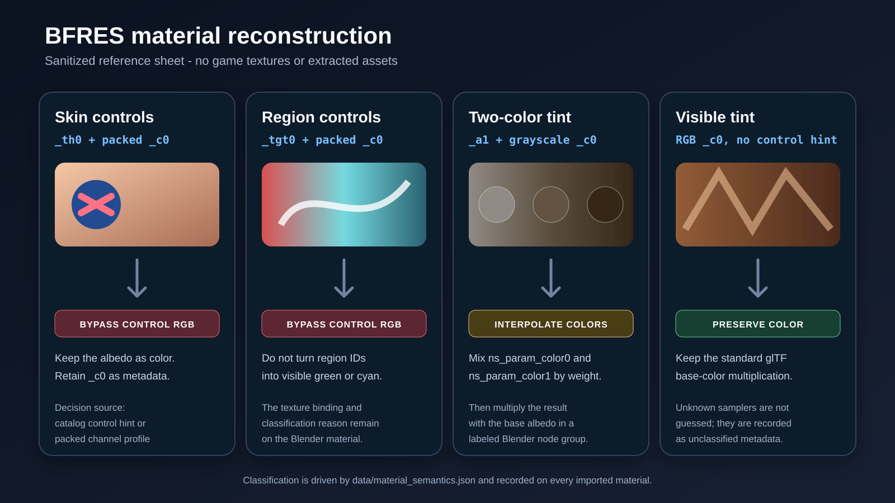

# BFRES material semantics

Material behavior is split into three layers:

1. `core/materials.py` safely reads BFRES 10 FMAT metadata.
2. `data/material_semantics.json` declares the meanings and confidence of
   known sampler names plus numeric classification thresholds.
3. `native_import.py` reconstructs direct static materials, while
   `material_mapping.py` classifies packed color attributes and adapts imported
   glTF graphs by topology.

This keeps title-specific semantics out of the binary parser and Blender UI
orchestration. Adding a newly verified sampler is a data change with schema
validation and unit tests, not a monkeypatch of Blender or an ignored
third-party checkout.

## Catalog schema

The packaged catalog has:

- a schema version and dated catalog version;
- the observed BFRES version;
- names of the two material-color shader parameters;
- thresholds for grayscale and packed-control profiles; and
- one record per known sampler with:
  - `role`;
  - `mapping`: `bfrass_gltf`, `blender_reconstructed`, or `metadata_only`;
  - `vertex_color`: `none` or `control_hint`; and
  - `confidence`: `verified`, `observed`, or `upstream`;
  - optionally, a `layer_blend` attribute, channel and confidence for a
    reconstructed secondary layer.

Unknown samplers are preserved as `metadata_only`, role `unknown`, confidence
`unclassified`. They never inherit a guessed Blender connection.

## Vertex-color decision order

The adapter classifies the color set feeding Principled Base Color:

1. If RGB is grayscale and `ns_param_color0` and `ns_param_color1` differ by
   the catalog threshold, use the grayscale value to interpolate those colors
   and multiply the result by the base albedo.
2. Otherwise, if the channel distribution looks packed or any sampler is a
   cataloged `control_hint`, bypass the visible multiplication.
3. Otherwise preserve glTF's standard visible vertex-color multiplication.

The ordering matters. A layered `_a1` material can still use a verified
grayscale two-color tint, while non-grayscale `_a1`, `_tgt0`, and `_th0`
control data is not displayed as RGB. On the direct static path, the observed
`_c0.r` channel instead drives the `_a0`/`_a1` blend before the generic packed
color multiplication is bypassed.

## Current sampler summary

| Samplers | Role | Current handling |
|---|---|---|
| `_a0`, `_albedo0` | Base color | BfrAss/glTF |
| `_n0`, `_normal0` | Normal | BfrAss/glTF |
| `_ao0` | Ambient occlusion | BfrAss/glTF |
| `_em0`, `_e0` | Emission | BfrAss/glTF |
| `_sd0`, `_s0`, `_r0`, `_rn0`, `_x0` | Generic shadow/specular/roughness/reflection | BfrAss/glTF |
| `_a1` | Secondary base-color layer | Direct static blend from `_c0.r`; metadata on glTF |
| `_tgt0` | Target or region control | Metadata plus vertex-control hint |
| `_th0` | Thickness or skin control | Metadata plus vertex-control hint |
| `_n1`, `_gn0`, `_gn3`, `_slt0` | Detail/generated normal or lookup data | Metadata only |
| `_rgh0`, `_mt0` | Roughness and metallic | Direct static path; metadata on the glTF path |
| `_rah0`, `_rah1` | Packed roughness/AO/height | Metadata only pending channel proof |

## Blender metadata

Each matched Blender material records:

- source material, shader archive and shader model;
- raw sampler bindings;
- catalog-enriched sampler roles and confidence;
- shader options and `ns_param_color0` through `ns_param_color5`;
- material-semantics catalog version;
- selected vertex-color mode and decision reason.

The imported collection records the catalog version and aggregate counts for
bypassed masks, reconstructed tints and preserved vertex colors.

## Direct static path

Standalone assets without an animation and level previews default to the
bundled `ootr_native` bridge. It gives Blender the pinned BfrAss/Assimp
parser's static mesh arrays directly, flattens the rest pose, bakes node
transforms, and avoids a per-model glTF file. A standalone import includes
every FMDL unless a level actor selects one by name. Referenced BNTX images are
decoded once, packed into the blend, and shared across level source
collections.

Blender reconstructs base color, normal, roughness, metallic and emission
nodes from verified sampler names. For `_a1` materials, `_c0.r` blends the
secondary albedo and the sampler's generated coordinate applies the FMAT
`ns_tex_mtx` scale. Materials declaring `ns_enable_alpha` use Blender's
dithered surface mode rather than showing the transparent region as an opaque
card. Unsupported static BFRES resources fall back to glTF.

Selecting a skeletal animation deliberately retains glTF for complete
armature, skin and rest-pose interchange. The FSKA curves themselves are still
decoded directly into a Blender Action.

## Clean native path

BfrAss already places BFRES material properties on its Assimp material, but
the generic Assimp glTF exporter does not carry arbitrary properties into a
standard glTF material. BFRES 10.4 also needs the separate external-string
resource to resolve hashed names.

A clean upstream replacement for the Blender adapter would require all of:

1. a BfrAss input for `ExternalBinaryString.bfres`;
2. external-hash resolution in BfrAss's BFRES 10 loader;
3. a documented glTF extension or `extras` schema for BFRES samplers,
   parameters and shader options; and
4. preservation of packed `_c0` as a custom attribute rather than standard
   `COLOR_0` when the source shader does not use it as display color.

Until that contract exists, the packaged parser/catalog/adapter is the
cleanest local boundary: no runtime monkeypatching, no edits to generated C,
no mutable third-party checkout, no material-name allowlist, and no loss of
the source metadata needed for future reconstruction.
